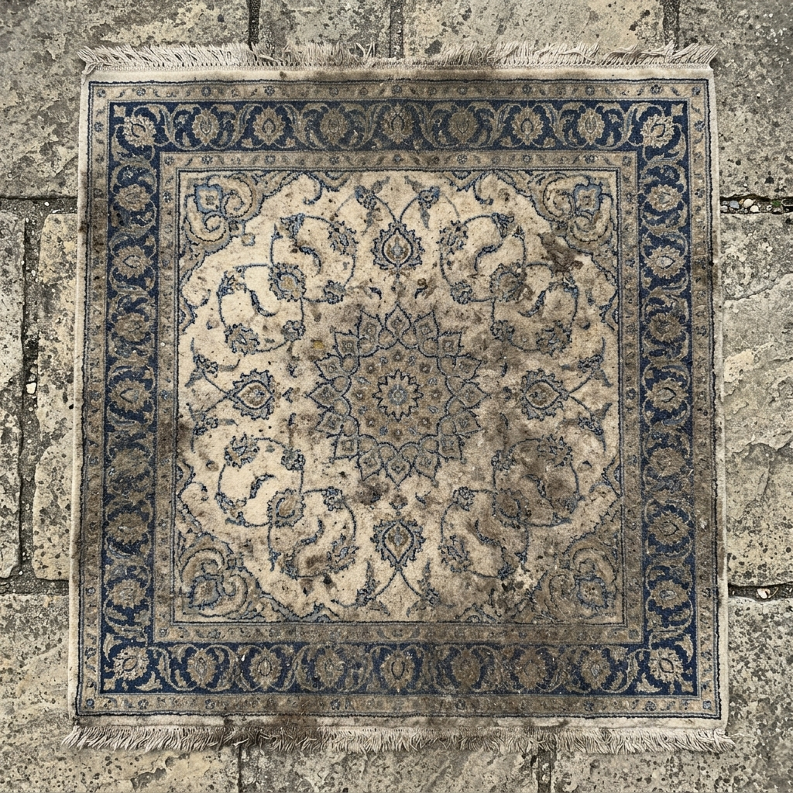
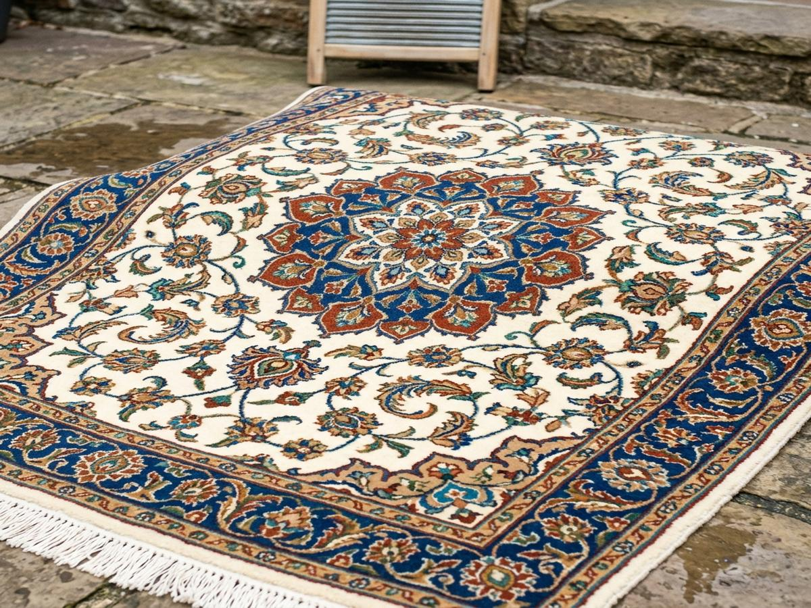

Persian rug cleaning before and after photographs show how professional rug washing can remove accumulated dirt and help restore the appearance of wool and silk fibers. A rug that has spent years in a busy living room may hold dust, soil, and everyday residue deep within its pile. Regular vacuuming helps with surface maintenance, but it does not replace professional cleaning.

For homeowners in Cambridge and the greater Boston area, Noor Oriental Rugs offers [professional hand washing](rug-cleaning.html) using natural and organic shampoos. Each Persian and Oriental rug deserves an appropriate cleaning approach based on its fibers, dyes, construction, and condition. Professional cleaning can help maintain the rug's appearance and support its long-term care.

<figure style="margin: 0; min-width: 0;"><figcaption style="margin-top: 0.5rem; font-size: 0.8rem; font-weight: 600; letter-spacing: 1px; text-transform: uppercase; color: var(--color-primary); text-align: center;">Before cleaning</figcaption></figure>
<figure style="margin: 0; min-width: 0;"><figcaption style="margin-top: 0.5rem; font-size: 0.8rem; font-weight: 600; letter-spacing: 1px; text-transform: uppercase; color: var(--color-primary); text-align: center;">After cleaning</figcaption></figure>

## What Makes Persian Rug Cleaning Before and After Results Noticeable?

The difference between a dirty Persian rug and a professionally cleaned one often becomes more apparent when the accumulated soil is removed. Dust and everyday residue can make the pile look dull, while areas with regular foot traffic may appear darker than less-used sections.

A Persian rug cleaning before and after comparison can reveal several changes:

- **Cleaner wool and silk fibers:** Removing accumulated soil helps the original surface become more visible.
- **Clearer design details:** Cleaning can make floral patterns, borders, and decorative motifs easier to see.
- **Improved pile appearance:** Removing embedded dirt can help the rug's pile look cleaner and less weighed down.
- **Cleaner fringes:** Professional attention to the fringe can improve the overall presentation of the rug.

Cleaning results depend on the rug's condition, fiber type, dye stability, and the nature of the stains. Some permanent discoloration, fading, and fiber damage cannot be reversed through washing alone.

## About Professional Cleaning of Fine Oriental Rugs

Persian and Oriental rugs are made using different materials, weaving techniques, and dyes. Many traditional rugs contain wool, silk, cotton foundations, or combinations of natural fibers.

These materials require appropriate care. Using an unsuitable cleaning product or excessive moisture can affect the fibers, dyes, and overall condition of a rug.

At Noor Oriental Rugs in Cambridge, Massachusetts, rugs are washed by hand using natural and organic shampoos. Hand washing allows the cleaning process to be approached with attention to the individual rug rather than treating every piece in the same way.

## Why Is It Important to Check Dye Stability?

Dye stability refers to the ability of a rug's colors to remain in place during cleaning. Some Persian rugs contain natural or vegetable dyes, while others use synthetic dyes. Both the dye type and the condition of the rug influence how it responds to moisture and cleaning products.

Color bleeding can occur when unstable dyes transfer from one area of the rug to another. Color fading can also affect the appearance of an Oriental rug.

Professional rug cleaners assess dye stability before washing, particularly when working with older, hand-knotted, wool, or silk rugs.

This assessment helps identify potential risks, including:

- Color transfer between light and dark areas.
- Fading in areas exposed to sunlight.
- Changes in wool or silk texture.
- Damage to weakened fibers.
- Existing stains or previous cleaning damage.

A careful assessment helps determine an appropriate cleaning approach for each rug.

## How Should You Prepare a Persian Rug for Professional Cleaning?

Preparing a Persian rug for cleaning begins with identifying its material, condition, and specific cleaning concerns.

Homeowners can take a few practical steps before arranging professional rug washing:

1. **Identify the rug:** Note whether the rug is made from wool, silk, cotton, or a combination of fibers.
2. **Describe visible stains:** Tell the cleaner about spills, pet accidents, water damage, or other problem areas.
3. **Mention previous cleaning:** Share any information about previous washing, stain treatments, or repairs.
4. **Check for moth activity:** Look for signs of moth damage, particularly in rugs stored in dark or undisturbed areas.
5. **Request an evaluation:** Have the rug assessed before deciding on a cleaning method.

Avoid experimenting with household stain removers, harsh chemicals, or excessive water. Incorrect treatment can spread stains or affect the rug's dyes.

## Professional Hand-Washing Process

Persian rug cleaning requires attention to the rug's construction and condition. At Noor Oriental Rugs, rugs are washed by hand using natural and organic shampoos.

The following stages explain the considerations involved in professional rug washing.

### 1. Initial rug evaluation

The rug's fibers, construction, colors, existing stains, and general condition should be assessed before cleaning. This helps identify areas that need special attention.

### 2. Dye and fiber assessment

Wool, silk, and natural dyes can respond differently to moisture and cleaning products. Assessing these characteristics helps determine an appropriate washing approach.

### 3. Hand washing

The rug is washed by hand using natural and organic shampoos. Hand washing provides an approach that takes the individual rug's material and condition into account.

### 4. Rinsing and cleaning residue removal

Rinsing is an important part of professional washing. Remaining cleaning residue can affect the feel and appearance of rug fibers.

### 5. Drying and final inspection

Proper drying helps prevent moisture-related problems, including mold and mildew. The rug should be thoroughly dried before being returned to regular use.

The exact requirements depend on the rug's material, construction, and condition.

## How Often Should Persian Rugs Be Professionally Cleaned?

Most Persian and Oriental rugs benefit from professional cleaning every 3–5 years. The appropriate interval depends on how the rug is used and the conditions inside the home.

Several factors influence cleaning frequency:

- **Foot traffic:** Rugs in living rooms, hallways, and entryways collect more dirt than rugs in rarely used rooms.
- **Pets:** Pet hair, accidents, and odors can increase cleaning needs.
- **Children:** Everyday spills and food residue can accumulate in family spaces.
- **Indoor dust:** Dust and airborne particles settle into rug fibers over time.
- **Storage conditions:** Rugs kept in storage require appropriate inspection and care before returning to use.

Regular vacuuming and prompt attention to spills help maintain a rug between professional cleanings. However, surface maintenance does not remove all the soil that accumulates within the pile.

## Can You Clean a Persian Rug at Home?

Yes, homeowners can perform basic maintenance on Persian rugs, including regular vacuuming and careful attention to small spills. However, complete Persian rug cleaning requires more knowledge of fiber types, dye stability, and appropriate washing methods.

Home cleaning attempts can create problems when the wrong products or excessive moisture are used.

For example, applying a strong stain remover to a wool or silk rug can affect its fibers or dyes. Scrubbing a stain aggressively can also damage the pile.

Professional cleaning is a better option for older Persian rugs, hand-knotted Oriental rugs, silk rugs, and pieces with significant staining or moth damage.

## Mothproofing and Long-Term Persian Rug Care

Moth damage is a concern for homeowners who own wool and other natural-fiber rugs. Moth larvae can damage rug fibers, particularly in areas that receive little disturbance or regular inspection.

Small signs of damage may appear as thinning pile, bare patches, or loose fibers.

Noor Oriental Rugs offers mothproofing as part of its rug-care services. Mothproofing can be considered when evaluating the care needs of a wool or Oriental rug, particularly when the rug has been stored or shows signs of moth activity. Existing moth damage can be repaired through our [rug restoration service](rug-restoration.html).

Regular inspection, proper storage, and professional evaluation can help homeowners identify potential problems before additional damage occurs.

## Professional Persian Rug Cleaning in Cambridge and Boston, Massachusetts

Noor Oriental Rugs serves homeowners looking for professional Persian and Oriental rug care in Cambridge and the greater Boston area.

The business focuses on hand-washed rugs using natural and organic shampoos. Whether you own a traditional Persian rug, a hand-knotted wool rug, or an Oriental rug that needs attention, an evaluation can help determine its cleaning requirements.

Professional cleaning is recommended every 3–5 years, depending on the rug's use and condition.

If your rug looks dull, has accumulated dirt, or needs attention after years of everyday use, consider having it professionally evaluated before attempting home cleaning.

## Request a Free Rug Evaluation from Noor Oriental Rugs

A Persian or Oriental rug deserves care based on its material, construction, and condition. Before choosing a cleaning method, have the rug evaluated to identify its needs and any potential concerns.

Noor Oriental Rugs welcomes homeowners in Cambridge and the Boston area to [request a free rug evaluation](index.html#contact). Contact Noor Oriental Rugs to discuss your rug and learn more about its [professional hand-washing](rug-cleaning.html) and mothproofing options.
